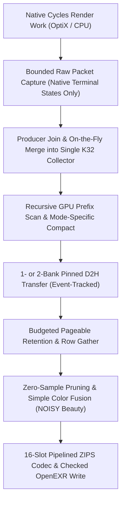

# Eliminating a 104× Slowdown: How We Made Cycles Deep EXR Fast and Production-Reliable

In our [previous Deep EXR engineering log](/blog/posts/2026-10-17-deep-exr-architecture), we explained why Deep EXR needed a ground-up architectural reset and deliberately noted that our early candidate milestones did **not** yet represent a performance boost. At that stage, our early full-extinction and archive prototypes were brutally slow—running **30×** slower on full-frame tests, and peaking at **64× slower (Simple) and 104× slower (Physical)** than Flat EXR in our October 23 diagnostic run (`454 s` and `737 s` vs. `7.1 s` Flat at 32 spp with host tracing).

Since then, we threw out the fragmented archive pipeline, shipped the bounded GPU-to-Host Deep EXR architecture in **5.2.4 LTS**, and expanded it in **[Industrial CG Platform 5.3.0](/en/industrial-cg-platform/releases/)** with native **World Volume Deep Support** and **zero-sample output pruning**.

On the same 2112×1272 production lighting scene (single RTX 4080 SUPER, OptiX, 21 multilayer EXR parts plus two Deep EXR outputs), that **64×–104×** slowdown is gone: shipped **5.3.0 Physical Mode** now runs at **1.11×–1.13×** Flat EXR time (+10.7%–12.5%), **Simple Mode** runs at—and on this test scene even slightly ahead of—paired Flat EXR wall time, and writing two full Physical Deep EXR outputs dropped from **24.8 seconds** down to **0.67–0.76 seconds**.

This post breaks down the exact architectural decisions that made Cycles Deep EXR fast—and just as importantly, the tempting "optimizations" we measured and threw away.

---

## Why Deep EXR Is Usually Slow

When a Deep EXR implementation slows a path tracer down by 2×–5×, the ray-tracing intersection itself is rarely the culprit. The real bottlenecks live downstream of the hit:

1. **Duplicate Work**: Running extra camera rays, separate full-extinction volume passes, or post-hoc CPU optical reconstruction multiplies ray-marching and shading cost.
2. **Unbounded Sample Growth**: Storing raw per-spp depth histories or dynamic per-pixel linked lists explodes VRAM usage, fragments allocations, and turns GPU memory access into irregular pointer chasing.
3. **Device-to-Host Traffic & CPU Reduction**: Streaming uncompressed raw samples over PCIe and sorting/merging them on the CPU stalls the entire render pipeline.
4. **Heavy File Packing & Codec Serialization**: Naive per-sample packing and single-threaded OpenEXR compression easily add seconds per frame on high-resolution shots.

To make Deep EXR fast without breaking physical compositing semantics, we had to attack all four stages as one continuous pipeline.

---

## The Shipped Pipeline at a Glance

In Industrial CG Platform 5.3.0, **OptiX handles capture, merging, prefix scan, and encoding directly on the GPU**, while the Host focuses strictly on bounded memory retention, row assembly, zero-sample pruning, and pipelined OpenEXR encoding/I/O. CPU rendering shares the same bounded numerical rules on its native host path.

Five engineering pillars carry the bulk of the speedup.

---

## 1. Zero Duplicate Production: Piggybacking on Native Terminal States

The fastest ray is the one you never trace twice.

Our shipped architecture **never** launches extra camera rays, never replays geometry for Deep, and never runs a separate full-extinction volume march. Instead, it taps directly into Cycles' native integrator terminal states:

* **Surfaces** record real `Z = ZBack` points directly from native hits, preserving native camera time, lens DOF, motion blur, pixel filter weights, and adaptive sampling.
* **Finite Volumes & World Volumes** reuse the exact native volume integration intervals and scattering events—deriving interval transmittance directly from the native input/output throughput ratio. In 5.3.0, unbounded World Volume fog keeps its localized foreground segments while folding the remaining infinite tail into a reserved far-depth slot (`1e10f`).
* **Mode-Specialized Kernels**: Whether a render needs `Alpha-only`, `Simple`, or `Physical` output is frozen before rendering starts. `Simple` and `Alpha-only` kernels compile out source-RGB accumulation paths entirely—there is no hidden per-sample RGB bookkeeping running behind a late runtime branch.

---

## 2. Single-K32 Collector: Cutting 16–20% by Deleting Complexity

Earlier prototypes used a **16-bucket** per-pixel collector with bucket heads, link bits, per-bucket parallel passes, and a final cross-bucket fold. On paper, splitting samples across buckets looked like a way to reduce contention. In practice, it created enormous memory, traversal, and kernel-launch overhead.

We replaced the 16-bucket layout with a **single bounded K32 collector per owned pixel** (at most 32 merged samples per pixel, plus bounded per-packet raw chains that retire and recycle immediately after producer join):

* **No bucket heads, no empty-bucket sweeps, no cross-bucket fold.**
* **Single-pass publish**: Because the single collector is already normalized along real effective sample population, final publication becomes a lightweight validated copy instead of a heavy multi-bucket merge. On `sm_89` (`cuobjdump` kernel analysis), final publish local stack dropped from **3,216 B (Simple) / 4,752 B (Physical) down to 0 B**, with register counts falling from **96 → 26** and **105 → 31**. *(Accumulate kernels still require local scratch—3,216 B / 4,800 B—so local working memory is reduced at publication, not magically eliminated everywhere.)*
* **Compact Lossless Identity Records**: When object/shader/normal identity fits within compact ranges, records shrink losslessly to **20 B (Simple) / 32 B (Physical)** instead of 24 B / 36 B—cutting GPU memory bandwidth directly.
* **Bounded Host State**: Removing full-frame reference arrays cut fixed bounded Host state from **96 B/pixel down to 16 B/pixel** (just two 8-byte indices per pixel).

### Same-Batch Benchmark: Legacy 16-Bucket vs. Shipped Single-K32

Measured on a single RTX 4080 SUPER (OptiX), full Blender render operator including file output on our production lighting test scene:

| Max Samples | Mode | Legacy 16-Bucket | Shipped Single-K32 | Single-Run Delta |
| :--- | :--- | ---: | ---: | ---: |
| 128 spp | Simple | 21.565 s | 17.845 s | **−17.25%** |
| 128 spp | Physical | 27.463 s | 22.843 s | **−16.82%** |
| 512 spp | Simple | 55.293 s | 44.000 s | **−20.42%** |
| 512 spp | Physical | 68.564 s | 57.444 s | **−16.22%** |

> **Memory Note**: In this batch, Frame-level Host ledger peak dropped by **~106–128 MiB**, while total process commit stayed roughly flat (~8.95–9.02 GiB) because larger admitted tiles and coexisting render payloads still occupy working memory.

---

## 3. On-the-Fly GPU Merging & Independent Tolerances

Every sample that survives capture has to be scanned, compacted, transferred over PCIe, unpacked, compressed, and written to disk. Reducing sample count *early* pays dividends at every single downstream stage.

Our shared CPU/OptiX merge pipeline runs directly as camera chains retire into the K32 collector:

1. **Semantic Surface Grouping First**: Compatible opaque surfaces sharing object, shader, and packed normal (within the `0.94` dot-product gate) merge together before local alpha is published—preventing anti-aliasing coverage differences from fragmenting a single clean surface into dozens of redundant samples.
2. **Independent Depth & Alpha Channels**: Under **Output Properties**, `Deep Merge Tolerance` (default `0.01`) and `Alpha Merge Tolerance` (default `0.01`) act as independent gates—samples merge if depth gap passes *or* local alpha difference passes within the projected depth neighborhood, while still respecting object/shader/normal and Physical color guards.
3. **Bounded Capacity Partitioning**: When a complex volumetric or hair pixel exceeds 32 mature candidates, a counting probe avoids wasted output rewrites and performs a single-pass cumulative-coverage partition down to ≤32 items.
4. **Shared Strict Model for Multi-Consumer Outputs**: If a scene writes multiple Deep EXR outputs with different tolerances, Cycles builds one upstream common model at the strictest requested tolerance and cheaply coarsens the ≤32-item list per output family—never re-running capture or optical reduction.

---

## 4. Simple Mode vs. Physical Mode: Paying Only for What the Shot Needs

Under **Render Properties → Performance → Deep**, **Simple Mode** is enabled by default for both surfaces and volumes:

* **Simple Mode (Default)**: Captures depth topology and encoded alpha on the GPU without allocating source-RGB caches or executing per-sample three-channel RGB atomics. During Host row packing, it fuses the native **undenoised Combined (NOISY)** beauty pass proportionally across each pixel's encoded alpha (`Beauty × clamp(A_encoded / D, 0, 1)`). Crucially, it does **not** wait for Cycles' denoiser to finish, while still respecting native tile and film completion order.
* **Physical Mode (Uncheck Simple Mode)**: Records true post-clamp source radiance directly at its native surface or volume depth. Use this when a shot has complex overlapping translucent layers or multi-depth volumetric emission where per-depth color separation matters.

Giving artists a clean toggle between the two means most production shots get near-zero color-capture overhead, while hero volumetric/transparent shots retain full physical depth color on demand.

---

## 5. Right-Sized Transfer Banks, Zero-Sample Pruning & Pipelined Host I/O

Once a tile finishes on the GPU, the remaining work is pure systems engineering:

* **Recursive GPU Prefix Scan**: Sample offsets are computed via a recursive block-total + uniform-add scan on the GPU rather than serial thread loops, keeping compaction fully parallel.
* **1- or 2-Bank Adaptive Transfers**: If a render has a single unique Deep encoding owner (the common case), Cycles allocates **one** encoded transfer bank instead of two, saving VRAM for larger tile admission. Multi-owner renders keep a 2-bank async pipeline tracked by copy events. As soon as a pinned D2H transfer lands, the Host moves it into budgeted pageable storage and immediately recycles the pinned bank.
* **Zero-Sample Pruning (Shipped in 5.3.0)**: Before packing scanlines for disk, the Host scans each pixel's encoded samples with a fast `nonzero_mask()` pass and strips all-zero samples (while preserving zero-alpha samples that still carry valid RGB emission in RGBA outputs). Across two Deep EXR outputs on our 5.3.0 regression scene, this pruned **1,111,157 samples (128 spp) / 903,691 samples (512 spp)** in Simple Mode and **961,887 samples (128 spp) / 852,796 samples (512 spp)** in Physical Mode before compression.
* **16-Slot Pipelined ZIPS Codec**: OpenEXR deep writing runs through a bounded 16-slot task pool using `ZIPS` level 1 compression and 32 KiB buffered sequential I/O. In Physical Mode on our 5.3.0 test scene, writing **two full 2112×1272 Deep EXR files** took only **0.762 s (128 spp)** and **0.674 s (512 spp)** end to end.
* **`Deep Tile Budget` (Default 1024 MiB)**: Rather than silently degrading spp, K32 capacity, or depth precision when VRAM gets tight, Cycles admits tile dimensions and packet sizes strictly within the configured budget—falling back to clean capacity errors if hardware limits are genuinely exceeded.
* **Deterministic Cancel & Failure Lifecycle**: Errors stay sticky (never silently cleared as success). On render cancellation or file-writer failure, Cycles stops new admission, drains only already-submitted GPU/Host work cleanly, prevents partial or corrupt Deep EXR files from being published, and performs a full state reset so subsequent renders in the same Blender session recover cleanly.

---

## Before vs. After: Flat EXR vs. Deep EXR End-to-End Overhead

To measure end-to-end impact on our shipped **5.3.0** build (which includes World Volume Deep Support and zero-sample pruning), we ran paired benchmarks on our existing production lighting regression scene (`1920×1080` + 5% overscan = `2112×1272`, World Volume socket unconnected in this scene, adaptive sampling, 21 standard multilayer EXR parts, and **two** Deep EXR files written to disk; single RTX 4080 SUPER, OptiX, full render operator including file write and close):

### Shipped 5.3.0 End-to-End Paired Timings

| Max Samples | Flat EXR | Deep Simple Mode | Simple vs. Flat | Deep Physical Mode | Physical vs. Flat |
| :--- | ---: | ---: | ---: | ---: | ---: |
| **128 spp** | 21.616 s | 19.136 s | **−11.47%** | 24.320 s | **+12.51%** |
| **512 spp** | 52.571 s | 44.812 s | **−14.76%** | 58.197 s | **+10.70%** |

### Overhead Progression Across Architecture Milestones (Same Scene, Separate Paired Batches)

| Architecture Milestone | Test Conditions | Simple vs. Flat | Physical vs. Flat | Key Bottleneck / Shift |
| :--- | :--- | ---: | ---: | :--- |
| **Oct 18 Prototype (`r8`)** | 32 spp, full-res | — | **30.5×** *(224.1 s vs. 7.4 s)* | 6,182 native domains, 381k queue updates, 113k page publications |
| **Oct 23 Two-Mode Archive (`production024`)** | 32 spp, full-res *(with host stage tracing)* | **64×** *(454.2 s vs. 7.1 s)* | **104×** *(736.8 s vs. 7.1 s)* | 2,334 micro-domains (1–3 spp), 2,167 tiny windows with repeated D2H spill → H2D reload; 19.2–24.8 s file write (106M–140M samples) |
| **Nov 9 16-Bucket Bounded GPU (`S15`)** | 128 / 512 spp, clean | **1.13×** *(+12.8%–13.2%)* | **1.37×–1.39×** *(+37.1%–38.9%)* | Switched to native terminal states; remaining cost in 16-bucket heads, sweeps, and cross-bucket fold |
| **Nov 23 Shipped 5.3.0 Single-K32** | 128 / 512 spp, clean | **Near-Flat** *(−11.5%–14.8%)* | **1.11×–1.13×** *(+10.7%–12.5%)* | Single K32 collector, 16 B/px Host state, 1/2-bank D2H, zero-sample pruning; 0.67–0.76 s Physical file write |

*(Each row compares Deep against its own same-batch Flat EXR run rather than mixing raw seconds across different builds or spp/tracing settings. The Oct 23 `64× / 104×` run included host-side stage tracing at 32 spp, whereas the Nov 9 and Nov 23 runs are clean 128/512 spp production timings.)*

Why did **Simple Mode** finish faster than Flat EXR in the 5.3.0 paired run? Enabling Deep activates `Deep Tile Budget` and bounded packet scheduling, which changes the effective tile size and render scheduling path compared to the default Flat run—while Simple Mode itself adds very little extra GPU work and sub-second Deep file I/O. We have **not** performed an isolated microarchitectural attribution (e.g., cache vs. wavefront breakdown) for that specific gap, so we treat it honestly: **do not assume Deep Simple Mode is universally faster than Flat EXR on every scene or GPU.**

What this result *does* prove is that Deep EXR is no longer a 2×–5× render-farm tax—in Simple Mode it sits right alongside Flat EXR speed, and even full **Physical Mode** dropped from **+37%–39%** down to **~11%–13%** overhead on this full production setup.

---

## What Sounded Fast—But Actually Made Renders Slower

Real performance engineering is defined as much by what you reject as by what you ship. Every candidate optimization in our tuning rounds was measured end to end, accounting for kernel launches, memory traffic, synchronization, register pressure, and file I/O. Several textbook ideas failed in real scenes and were reverted:

* **Separate Async Compute Stream for Deep AA**: Overlapping Deep reduction on a separate GPU stream showed zero stable frame-time gain (`27.259 s vs. 27.125 s` at 128 spp; `76.359 s vs. 75.748 s` at 512 spp) while adding synchronization complexity. Removed.
* **Doubling OpenEXR Codec Concurrency (16 → 32 Slots)**: Throwing more CPU threads at `ZIPS` compression increased memory contention, task overhead, and budget-lock traffic, performing equal or slower than 16 slots. Kept at 16.
* **Aggressive Counter Batching**: Reducing small counter readbacks by batching work more aggressively actually slowed full frames by **~10%** (`29.646 s vs. 26.865 s` at 128 spp; `75.911 s vs. 68.515 s` at 512 spp) due to worse scheduling cadence. Reverted.
* **Lowering Register Caps for "Higher Occupancy"**: Capping Simple Volume kernels at 48 registers (resulting in 40 actual regs) increased local stack spilling and made both 128 and 512 spp noticeably slower than our validated 64-thread / 64-register profile.
* **Forcing Largest Possible Tiles**: Maximizing tile size sounded good for launch reduction, but hurt overall render speed compared to budget-guided tile admission.
* **Copy-Pasting Simple Kernel Tunings onto Physical**: Sharing Simple's kernel launch profile on Physical Mode produced no speedup (and even caused slice mismatches in one shared-memory experiment). Each mode keeps its own validated execution profile.

---

## Objective Boundaries & Current Scope

Consistent with our engineering reporting standard, here is what these results **do** and **do not** cover:

| Area | Verified Scope | What Is NOT Claimed |
| :--- | :--- | :--- |
| **Hardware & Backends** | Windows x64 **NVIDIA RTX OptiX** (measured on RTX 4080 SUPER) and **CPU** native paths. | Cross-GPU scaling across other GPUs/architectures, multi-GPU entity migrations, and non-OptiX GPU backends (platform supports NVIDIA RTX OptiX and CPU only). |
| **Benchmark Scope** | Single-machine, single-run paired end-to-end operator timings on our 2112×1272 production lighting scene (World Volume unconnected; World Volume Deep was validated separately on dedicated fog scenes) with 21 EXR parts + 2 Deep outputs. | Universal guarantee that Simple Mode beats Flat EXR on arbitrary scenes, or statistical multi-run variance bounds. |
| **Deep Precision** | Bounded K32 per-pixel representation with native Surface, finite Volume, and 5.3.0 World Volume support. | Infinite lossless sample storage; heavy K32 capacity pressure can merge overlapping layers, and refractive glass does not reconstruct post-refraction background depth. |
| **Memory Profile** | Fixed bounded Host state reduced from 96 → 16 B/pixel; `Deep Tile Budget` enforces explicit device admission bounds. | Proportional reduction in total OS process commit peak across all workloads. |

---

## Try It Today

The full bounded Deep EXR architecture—including **Simple / Physical modes**, **independent Depth & Alpha merge tolerances**, **World Volume Deep Support**, and **zero-sample output pruning**—is available now in **[Industrial CG Platform 5.3.0](/en/industrial-cg-platform/releases/)**.

For setup steps, UI parameters, and Nuke `DeepMerge` guidance, read the **[Deep EXR Feature Manual](/en/industrial-cg-platform/features/deep-exr)**.
