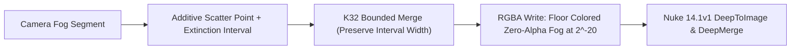

# Bringing Arnold-Style Atmosphere Volume to Cycles: 1,000-Light 4K Thin Beams, Interactive Viewport & Deep EXR

::: info Development Update · 90% Complete (In Progress)
`Atmosphere Volume` is currently in **candidate verification** (not yet shipped in a public stable release). Track live milestone status on our [Feature Tracking Board](/en/feature-tracking).
:::

Lighting artists coming from Arnold to Blender Cycles often miss one deceptively simple tool: **`atmosphere_volume`**.

In stock Blender, adding volumetric light beams ("God Rays") across an entire city or concert stage usually means plugging a `Volume Scatter` shader into the World output. That forces full-scene volumetric path tracing—expensive to evaluate, noisy on narrow spotlights, and painful to control in compositing.

Over the past few months, we have been building an Arnold-style **`Atmosphere Volume`** World shader node and dedicated **`Atmosphere`** render pass directly inside Cycles. Today, the feature has reached **90% completion** after clearing three major engineering milestones:

1. **4K 1,000-Light Thin-Beam Quality & Speed**: On our 4K city benchmark (500 spotlights + 500 disk area lights), our OptiX prototype matched—and in seed stability outperformed—our local Arnold 7.2.4.1 AA 8 reference on razor-thin **1° spotlight beams**, while portable GPU culling cut 4K render time by **33.8%–37.8%**.
2. **Atmosphere Deep EXR Acceptance**: Across both our **5.2.5** and **5.3.1 pre-acceptance** release candidates, Atmosphere Deep passed Windows CPU/OptiX verification, 4K 1,000-light same-frame parity, and **Nuke 14.1v1** flattening and `DeepMerge` insertion checks.
3. **Interactive Viewport Benchmark on 1,000 Lights**: On Windows OptiX, interactive viewport fog-toggle testing on the full 1,000-light city scene measured **~10–12 viewport updates per second** while orbiting/dragging with fog active.

Here is how the architecture works, the mathematical bug behind thin-beam fireflies, and what remains before public release.

---

## 1. First Principles: Why a Dedicated Camera-Primary Estimator

Rather than treating full-scene `Volume Scatter` as something to brute-force with higher sample counts, `Atmosphere Volume` is built around the same pragmatic scope that makes Arnold's `atmosphere_volume` fast in production:

* **Camera-Primary Single Scattering**: Each camera segment evaluates direct single scattering (`camera ray → atmosphere segment → local light`) with zero hidden multi-bounce volume explosion.
* **Explicit Local Light Scope**: The estimator focuses strictly on lights with well-defined local geometry—**Point**, **Spot**, and **Area** lights—preserving Cycles' native light energy evaluation, inverse-square falloff, spot cone softening, area spread, and native camera pixel filters (such as Blackman-Harris).
* **Artist-First Controls & Dedicated Pass**: Artists dial in `Density`, `Color`, `Attenuation`, `Attenuation Color`, Henyey-Greenstein `Anisotropy`, `Camera` visibility, and `Samples per Light`, with a dedicated `Atmosphere` render pass ready for compositing.

---

## 2. Fixing 1° Spotlight Fireflies: 0.031% → 100% Geometric Hit Rate

Our hardest visual stress test is a **3840×2160 (4K) night city with 1,000 lights** (500 Spot + 500 Disk Area), featuring razor-thin **1° spotlights** (`radius = 0.015`, soft falloff) cutting upward across the frame.

Early OptiX prototypes produced continuous beams, but showed stubborn bright speckles that jumped around between random seeds. Turning shadows completely off barely changed the error (`max linear RGB delta = 3.58e-7`), proving the fireflies were **not** shadow noise—they were **light-sampling variance**.

Why? Cycles models a finite-radius spotlight as a disk facing the scatter point. When a scatter point sits close to the lamp (say `0.03` units along the axis), the disk subtends a huge solid angle—yet the actual **1° beam** occupies only a tiny fraction of that disk. Sampling uniformly across the disk meant **only ~0.031% of samples landed inside the 1° cone**; the rare hits carried massive compensating weights and exploded into fireflies.

### The Fix: Invert the Sampling Order

For narrow beams whose cone angle is smaller than the disk's subtended angle, we inverted the sampling order inside the Atmosphere estimator:

1. **Sample a direction inside the narrow 1° beam first.**
2. **Intersect that direction back against the original emitter disk.**
3. **Weight by the new solid-angle PDF**, keeping the exact original disk shape, lamp radius, spot falloff, transmittance, and shadow test intact.

On our isolated analytical check (`radius = 0.015`, `1°`, `0.03` units on-axis), geometric hit rate jumped from **~0.031% to 100%**, matching the analytical on-axis integral within **<0.09%** across three seeds.

### 4K 1,000-Light Thin-Beam Stability (Two 1° Blue Beams, 200 Rows Each)

Comparing the maximum pairwise relative RMS difference across three random seeds on the exact same 200-row beam profiles (RTX 4080 SUPER, OptiX):

| Renderer / Configuration | Left Beam Max Seed Diff | Right Beam Max Seed Diff | Along-Beam Fluctuation (L / R) |
| :--- | ---: | ---: | ---: |
| Previous Cycles Prototype (512 spp) | 7.16% | 10.50% | — |
| **New Cycles Sampling (128 spp)** | **1.41%** | **1.50%** | 1.01% / 0.93% |
| **New Cycles Sampling (512 spp)** | **1.37%** | **1.46%** | 0.95% / 0.97% |
| Local Arnold 7.2.4.1 AA 8 (64 camera spp) | 8.05% | 2.61% | 3.21% / 1.71% |

Both beams stayed continuous across all `200 / 200` rows (~`1.20 px` width vs. Arnold's `~1.11 px`), and whole-frame 128-vs-512 spp linear Atmosphere RMS error dropped from **8.34% down to 3.86%**. *(Note: A high-sample Arnold AA 16 single-seed reference reaches `0.25% / 0.25%` along-beam fluctuation; Cycles and Arnold keep their own light scales and filters, so this comparison measures beam continuity, width, and seed stability.)*

---

## 3. Scaling to 1,000 Lights at 4K: Per-Light Budgets & Conservative Culling

High-quality thin beams are useless if 1,000 lights take ten minutes per frame. We attacked performance in two clean steps inside Cycles' shared integrator—no extra ray queues, no per-ray allocations, and no extra kernel launches:

### Step A: `Samples per Light` Budget Calibration

Each intersecting light takes `Samples per Light` stratified samples along the camera segment, and all candidates share a single weighted selection so at most **one Atmosphere shadow ray** is traced per camera sample.

Sweeping budgets from `1` to `64` on the 4K 1,000-light city showed that **`8` samples per light** was the first budget to clear our thin-beam stability bar at both 128 and 512 spp—cutting full-frame render + file-write time by **31.2%** at 128 spp (`71.54 s → 49.21 s`) and **27.3%** at 512 spp (`258.64 s → 188.05 s`) compared to 64, with beam width shifting by less than **0.001 px**.

### Step B: Conservative Geometric Culling & Loop-Invariant Hoisting

Profiling the 4K 1,000-light render showed that evaluating non-intersecting lights and recomputing equiangular parameters inside the stratified loop dominated shading time. We added:

* **Conservative Leaf-Group Culling** (default 8 lights per leaf group): Skips entire groups of non-intersecting lights in-place while preserving exact light ordering, intervals, and fallback to linear traversal for unbounded or mixed-direction groups.
* **Loop-Invariant Hoisting**: Moves equiangular distribution setup, random rotation, and constant light-emission terms outside the per-light stratified loop.
* **Separated Procedural Fog Path**: Keeps homogeneous fog on a tight direct path while isolating procedural density evaluation.

### 4K 1,000-Light OptiX End-to-End Speedup (Fixed 8 Samples/Light, RTX 4080 SUPER)

| Camera Samples | Before Portable Optimizations | After Portable Optimizations | Time Saved |
| :--- | ---: | ---: | ---: |
| **128 spp** (incl. file write) | 48.38 s | **32.02 s** | **−33.8%** |
| **512 spp** (incl. file write) | 181.88 s | **113.15 s** | **−37.8%** |

Numerical fidelity remained locked: comparing culled traversal against identical-math linear traversal yielded a whole-frame 128 spp RGB RMS difference of just **`1.21e-8`**. *(And just like our Deep EXR tuning, lowering register caps to chase higher theoretical occupancy backfired due to spilling—slowing 128 spp from `35.29 s` to `39.50–42.55 s`—so those variants were discarded.)*

---

## 4. Atmosphere Deep & Interactive Viewport Verification

The latest milestones—pushing `Atmosphere Volume` to **90%** on our roadmap—bring native integration with our bounded **K32 Deep EXR** architecture across both our **5.2.5** and **5.3.1 pre-acceptance** candidates, alongside real-world interactive viewport validation on the 1,000-light city scene (**~10–12 updates/s** while dragging with fog active on Windows OptiX).

Wiring atmospheric light beams into Deep EXR uncovered three subtle compositing traps that we had to solve cleanly:

1. **The Nuke Zero-Alpha Drop Trap**: Purely emissive/scattered light beams can carry positive RGB color with near-zero optical extinction (`Alpha ≈ 0`). When we tested real **Nuke 14.1v1** `DeepToImage` readback, Nuke silently discarded colored fog points whose Alpha was exactly `0`—causing a `0.0747` max RGB error in FLOAT!
   * **Solution**: On RGBA Deep output, any colored fog sample with near-zero Alpha receives a minimum floor of **`2^-20`** (representable in both 32-bit FLOAT and 16-bit HALF, capping total per-pixel K32 Alpha addition to `2^-15`, while Alpha-only outputs remain untouched). That single fix dropped Nuke 14.1v1 FLOAT RGB error from **`0.0747` down to `3.73e-6`** (and HALF down to `5.26e-5`).
2. **Colored Transparency Chains & K32 Interval Width**: In Deep mode, camera rays passing through colored transparent surfaces now continue tracing to the transparency bounce limit rather than terminating stochastically and losing background fog segments (cutting isolated CPU Alpha error from **22.21 percentage points down to `1.51e-6`**). We also fixed K32 merging when a zero-Alpha fog point leads an extinction interval so interval width and occlusion depth remain intact (512 spp dual-colored spot transmittance error under K32 pressure: **`8.60e-6` CPU / `7.65e-6` OptiX**).
3. **Local Volumes + Fog Overlap**: When a local mesh volume and Atmosphere fog overlap the same camera segment, Deep reuses the native Beer-law transmittance interval and splits cleanly at shared boundaries.

### Candidate Verification Summary (5.2.5 & 5.3.1 Pre-Acceptance Builds)

| Verification Suite | Verified Result |
| :--- | :--- |
| **Windows CPU / OptiX Matrix** | Flattening, front/mid/back insertion, local volume, colored transparency, holdout, procedural fog, 21-layer transparency stress, thick fog FLOAT/HALF, and Alpha-only passed on both candidates (base flatten max RGBA delta: **`8.30e-5`**). |
| **Nuke 14.1v1 Real Readback** | 6 composited outputs verified per candidate: dual-color fog RGB flatten max delta **`3.58e-7` (FLOAT)** / **`8.31e-5` (HALF)**; 3-depth `DeepMerge` white-card insertion max transmittance delta **`0.002333`**. |
| **4K 1,000-Light Twin Output (Flat + HALF Deep)** | Single-pass Flat + HALF Deep on RTX 4080 SUPER OptiX (92,160 sampled pixels, ≤32 samples/pixel; `198.5M` total Deep records at 512 spp): mean absolute RGB delta **`≤ 2.21e-5` (128 spp)** / **`≤ 1.07e-5` (512 spp)**, max **`~0.001`**. |

---

## 5. Honest Boundaries & What Is Still Pending

Because `Atmosphere Volume` is still **in progress**, we want the remaining work and known boundaries to be completely transparent:

* **Heterogeneous Local-Volume Pressure**: On an extreme 4096 spp local heterogeneous volume + fog insertion stress test, bounded K32 approximation showed a **`0.01131`** max transmittance error—documented as an expected K32 capacity tradeoff rather than hidden.
* **Adaptive Sampling & Default Budget**: In early adaptive stress tests (`threshold = 0.1`, stopping at `32 spp`), thin-beam fluctuation rose above the Arnold AA 8 bar (`2.35% vs. 1.71%`). Finalizing the default `Samples per Light` budget and validating adaptive stopping in fog-dominated shots remain on our checklist.
* **Remaining GPU Backends, Denoising & Public Release**: While Windows OptiX interactive viewport fog toggling is verified (~10–12 updates/s on 1,000 lights), interactive/render performance on other supported GPU backends, large multi-light/area-light denoising and convergence qualification, 5.2.5 / 5.3.1 production branch merge, and final public release packaging are still pending.

We will share a follow-up announcement as soon as `Atmosphere Volume` graduates from candidate verification into a public Industrial CG Platform release. Until then, you can follow live progress on the [Feature Tracking Board](/en/feature-tracking).
