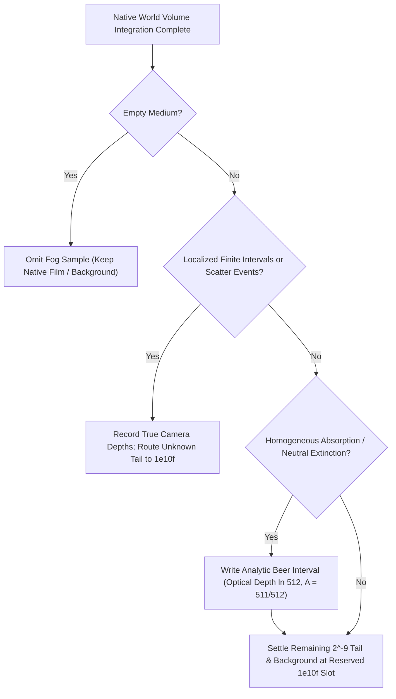

# Deep EXR for Unbounded World Volumes: Shipping World Volume Deep Support in 5.3.0

In **[Industrial CG Platform 5.3.0](/en/industrial-cg-platform/releases/)**, native Cycles Deep EXR output officially extends to **Blender's native `World Output → Volume` shaders**—closing one of the biggest remaining gaps between stock Blender's volumetric environments and production Nuke deep compositing.

Finite volume objects (like a VDB smoke plume) have clean entry and exit bounds. A **World Volume**, by contrast, stretches from the camera lens all the way to infinity. That single difference breaks naive Deep EXR implementations in three ways:

1. **Writing `+Inf` Depths**: Non-finite depth coordinates break downstream sorting, resampling, and `DeepMerge` in Nuke.
2. **Truncating at Camera Far Clip**: Clamping world fog to the camera far clip plane silently alters transmittance and breaks visual parity with the native Flat beauty pass.
3. **16-Bit HALF Opacity Collapse**: A long homogeneous fog ray that approaches `Alpha = 1.0` easily quantizes to solid `1.0` in 16-bit HALF—making any background element or distant deep insert disappear behind an artificially opaque wall.

Here is how we solved unbounded World Volume Deep inside our existing bounded K32 architecture without adding extra rays, extra shader evaluations, or new UI toggles.

---

## 1. Zero Extra Rays: Tapping Native Volume Integration

World Volume Deep plugs directly into Cycles' native volume integration path on both **CPU** and **NVIDIA RTX OptiX**, supporting all three existing output modes (**Simple**, **Physical**, and **Alpha-only**):

* **No extra camera rays, no second ray-march, no far-clip truncation.**
* **Native VolumeStack Overlap**: When a local mesh volume (such as a VDB cloud) sits inside a World Volume, Deep consumes the combined native `VolumeStack` integration result directly—and transparent surfaces or holdouts continue following the existing camera-chain coverage rules.
* **No New UI Switches**: Enabling `Deep EXR` in Scene Output or a Compositor `File Output` node automatically captures active World Volume shaders.

---

## 2. How Unbounded Rays Are Represented

When a camera ray traverses an unbounded World Volume and misses all finite geometry (native `FLT_MAX`), Cycles classifies the result into four clean cases:

| Native Integration Outcome | Deep EXR Representation |
| :--- | :--- |
| **Empty Medium** | Fog samples are omitted; ordinary or transparent backgrounds follow the native Film branch. |
| **Valid Finite Intervals or Real Scatter Events** | True camera depths are preserved through the existing capture and merge pipeline. Neither procedural Octree box exits nor biased ray-marching sentinel steps are treated as fake physical boundaries—whatever can be localized is recorded in place, and any unlocalized remainder goes to the far slot. |
| **Homogeneous Absorption / Neutral Extinction (No Finite Hit)** | Writes a single analytic Beer interval with total optical depth **`ln(512)`**, giving **`Alpha = 511/512` (`0.998046875`)**—a value that is **exact in both 16-bit HALF and 32-bit FLOAT**. This prevents 16-bit quantization from collapsing long fog segments into solid `1.0` opacity. The remaining `2^-9` tail settles cleanly into the far endpoint without double-counting coverage. |
| **Unlocalized Coverage, World Background & Visible Sun** | Stored once at a single fixed finite depth—**`1e10f`**—using the background identity. Ordinary World backgrounds and visible Sun radiance anchor here rather than leaking onto foreground depths, while `Film Transparent` keeps transparent backgrounds strictly transparent. |

---

## 3. Protecting K32 Capacity, HALF/FLOAT Parity & Depth Anchoring

Three subtle details make the difference between a prototype that flattens cleanly and a production Deep EXR that survives Nuke `DeepMerge`:

1. **Reserved Far Slot in K32**: Inside our bounded 32-sample-per-pixel collector, the `1e10f` far endpoint is extracted and accumulated separately from finite samples—consuming **at most 1 of the 32 slots** while finite foreground/midground samples use up to 31 slots. Ordinary merge tolerances and K32 capacity pressure never merge finite foreground fog into the infinite far endpoint.
2. **Shared HALF / FLOAT Depth Model**: `Z` and `ZBack` remain 32-bit FLOAT in both formats. HALF and FLOAT share the exact same depth intervals, ordering, and merge rules—no HALF-only alpha hacks or brightness patches—so any difference between the two is purely expected final RGBA quantization.
3. **Preventing Distant Sun/Background Leaks onto Foreground Inserts**: In our directed test placing a transparent card at **5 meters** in front of a visible Sun with World Volume active, 5.3.0 accurately anchored the visible Sun's red-channel contribution (`max R = 0.692433`) to the **`1e10f`** far endpoint while keeping finite foreground RGB strictly at `0`.

---

## 4. Shipped 5.3.0 Verification: Nuke 2 m / 20 m Inserts & Real Cost

We validated the shipped Windows **5.3.0** build on a derived `1600×900`, `192 spp`, OptiX (`ZIPS`, default `0.01 / 0.01` tolerances) Cyberpunk alley scene featuring 13 native lights, homogeneous and procedural fog variants, transparent foreground geometry, and overlapping local volumes:

### Real Nuke Readback & `DeepMerge` Insertion (Physical HALF, Default Tolerances)

* **Full-Frame Readback**: `133,794` far-endpoint (`1e10f`) pixels read cleanly; ordered Deep flatten matched native Flat EXR within **`5.76e-4`** max RGBA difference.
* **2 m & 20 m Nuke Inserts**: Inserting test cards at both **2 meters** and **20 meters** inside Nuke `DeepMerge` and re-saving preserved the `1e10f` far slot cleanly. At the 20-meter cut, the carrying fog interval held `Alpha = 0.996582` with **`0.05370`** foreground prefix transmittance—matching our independent compositor oracle within **`4.14e-4`** max channel error.
* **Procedural High-Extinction Empty-Sky Checks**: Passed on both unbiased (`57` endpoint pixels) and biased ray marching (`20,736` endpoint pixels).
* **Automated Regression Coverage**: `326` Cycles Deep GTests passed (`28` conditional skips) plus `11 / 11` Blender `deep_exr_output` integration tests passed.

### Honest Performance Numbers (Cyberpunk Alley, 1600×900, 192 spp, OptiX, Default `0.01/0.01`)

Unlike ordinary surface-dominated shots where Deep Simple Mode runs near Flat speed, enabling a full-scene **World Volume** populates nearly every pixel across the entire frame with long volumetric intervals and scattering samples (`34.0M–42.3M` stored samples in Physical FLOAT on this scene):

| World Volume Variant | Flat EXR | Simple FLOAT | Physical FLOAT | Physical HALF |
| :--- | ---: | ---: | ---: | ---: |
| **Homogeneous Absorption** | 2.615 s | 6.338 s | 7.962 s *(3.04×)* | 7.978 s |
| **Scattering + Transparent Foreground + Local Volume** | 5.247 s | 11.244 s | 13.150 s *(2.51×)* | — |

In full-frame World Volume shots, you are genuinely storing tens of millions of depth intervals across the entire image—so expect roughly **2.5×–3.0×** render-plus-write time in Physical Mode at default `0.01` tolerances on dense volumetric frames.

---

## 5. Current Boundaries & Choosing the Right Fog Tool

* **Current Scope**: World Volume Deep supports native `World Output → Volume` shaders with real extinction/scattering on **CPU** and **NVIDIA RTX OptiX**. Pure zero-extinction volumetric emission, colored transmission, and Deep Shadow Catcher remain outside the current Deep EXR scope.
* **Need Fast Volumetric Light Beams Instead of Full-Scene World Volume?** If your shot needs Arnold-style volumetric spotlight/area beams ("God Rays") with near-real-time viewport feedback and native Deep EXR output—without full-scene volumetric path tracing—check out our [Atmosphere Volume 90% Devlog](/blog/posts/2026-11-26-atmosphere-volume-devlog).

World Volume Deep Support is available right now in **[Industrial CG Platform 5.3.0](/en/industrial-cg-platform/releases/)**. For configuration steps and Nuke workflow guidance, see the **[Deep EXR Feature Manual](/en/industrial-cg-platform/features/deep-exr)**.
